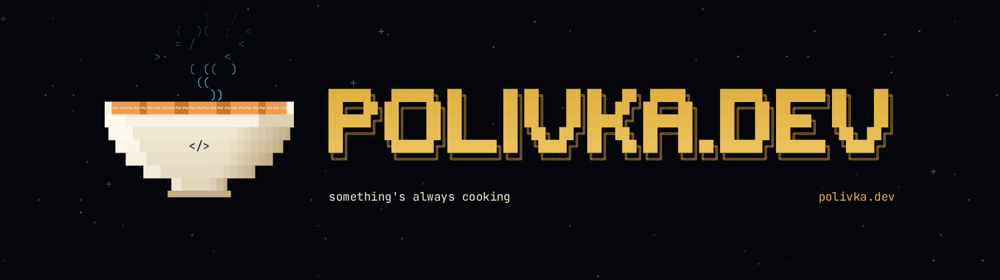

  

  <b>Pavel Polívka</b> · tech lead who still codes · 15+ years of shipping · near Prague 🇨🇿 
  <i>Developer, music lover, writer and BATMAN!!!!!</i> 🦇

  
  
  
  

---

*Polívka* is Czech for soup. Something's always cooking: by day I lead a dev team, after hours I build games, dev tools and odd things for my house, mostly together with **Claude Code**. It types, I review.

## 🍲 On the stove

| | What it is |
|---|---|
| 🛰️ **[Signal Fall](https://github.com/polivkadev/signal-fall)** | Fast C&C-style sci-fi RTS in the browser: three factions, generated maps, skirmish vs AI, online 1v1/2v2 with Elo, voiced campaigns. Built end to end with Claude. **[Play it →](https://signal-fall.app)** |
| 💬 **[Feedbacker](https://github.com/polivkadev/feedbacker)** | My AI agent writes the code, I review it like a merge request. Line comments across several repos, sent back to the agent. CLI, MCP server, Claude Code plugin. `npx agent-feedbacker` |
| ✨ **[Golden Record](https://github.com/polivkadev/golden-record)** | Dark space theme for [Omarchy](https://omarchy.org): gold accents, NASA backgrounds that follow the time of day. The whole brand is in its colours. |
| 🏠 **[homelab-mcp](https://github.com/polivkadev/homelab-mcp)** | MCP server that lets Claude see what runs on my home servers and fix it over SSH. |
| 🤖 **[Ten druhý](https://github.com/polivkadev/ten-druhy)** | Family chatbot in the voice of a character from Czech sci-fi books. It has long-term memory and dreams at night. Yes, really. |
| 📺 **[code-stream-overlay](https://github.com/polivkadev/code-stream-overlay)** | Live OBS overlays for coding streams: what you're building, progress, test status. `npx code-stream-overlay` |

## 🥄 Served earlier

- **[GitLab Projects](https://github.com/polivkadev/GitLabProjects)** ⭐ 120+: GitLab merge requests and snippets inside JetBrains IDEs.
- **[gitcleaner](https://github.com/polivkadev/gitcleaner)**: removes stale git branches from JetBrains IDEs.
- **[convert-anything](https://github.com/polivkadev/convert-anything)**: modular CLI that converts audio, image and video files.

## 🪦 Didn't make it

Plenty of side projects never got finished. The best of them have tombstones in the **[graveyard on polivka.dev](https://polivka.dev/#graveyard)**.

## 📺 Videos and ✍️ writing

Videos about building things with AI, the bugs included: **[youtube.com/@polivkadev](https://www.youtube.com/@polivkadev)**. First episode is still cooking.

Latest on [dev.to](https://dev.to/polivkadev):
- [I got tired of Google Discover, so I built my own news feed in a day](https://dev.to/polivkadev/i-got-tired-of-google-discover-so-i-built-my-own-news-feed-in-a-day-1g2c)
- [I review my AI agent's code like a merge request](https://dev.to/polivkadev/i-review-my-ai-agents-code-like-a-merge-request-3elj)
- [Google Sheets is my favourite free backend](https://dev.to/polivkadev/google-sheets-is-my-favourite-free-backend-4no5)

---

Daily driver: Omarchy on Asahi Linux on an M1 MacBook Air · Zed · Home Assistant · too much coffee ☕

